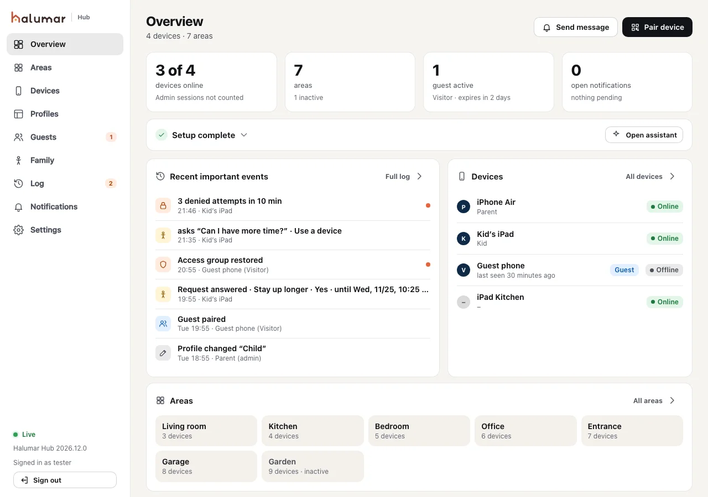
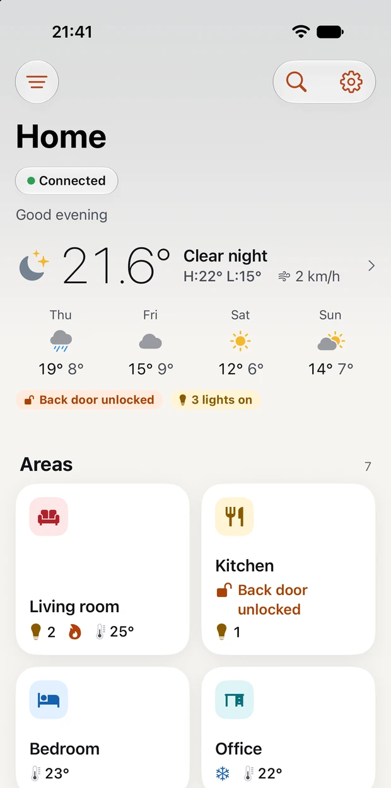

<h1 align="center">
  <picture>
    <source media="(prefers-color-scheme: dark)" srcset="docs/images/brand/halumar-wordmark-on-dark.svg">
    
  </picture>
  <br>Hub
</h1>

The Halumar Hub is a Home Assistant app (add-on) that gives every device in your home its own,
limited view of Home Assistant. You decide in one admin page what a wall panel, a guest's phone,
a child's tablet, a TV or a watch may see and control. The hub pairs these devices, keeps their
profiles and rules, and serves layouts and settings to the Halumar apps.

**Who it is for:** Home Assistant users who want to hand a device to someone (family, guests, a
babysitter) or mount one on a wall without giving it the full Home Assistant.

<p>
  
  
</p>

## Status

Version **2026.12.0** is the first public release. Hub and integration of the same version
belong together. The protocol between hub, integration and apps (the
[contract](https://github.com/Halumar/contracts)) has its own version; the hub pins it to the tag
in [`.github/contracts-ref`](.github/contracts-ref).

The Halumar apps for iPhone, iPad, Apple TV and Apple Watch are in beta; install them through
TestFlight: <https://testflight.apple.com/join/fHX7YT8v>. The apps for Android phone and tablet
(wall panel) and Android TV are not available yet.

## What it does

- **Admin page in the Home Assistant sidebar:** areas, sections, entity tiles and widgets on a
  grid, with a preview per device type.
- **Devices:** iPhone, iPad, Apple TV, Apple Watch, Android phone and tablet (also as a wall panel)
  and Android TV. Pairing with a PIN, a QR code or a setup link. A paired phone or tablet (iPhone,
  iPad, Android phone or tablet) can set up other devices when its profile allows it; an iPhone sets
  up its own Apple Watch.
- **Profiles and rules:** every device has exactly one profile. A profile holds a value for each
  rule (areas, how much the device may control, remote access, features, appearance). Rules can
  be fixed for all devices of a profile or adjusted for a single device, also for a limited time.
- **One Home Assistant user per device**, created and removed by the [Halumar
  integration](https://github.com/Halumar/integration). The rule **Home Assistant access** sets
  three levels: **Hub only** (without remote access the device gets no Home Assistant key and reads
  and switches only through the hub; the default for guests, babysitters, house sitters,
  children and the Kids' room panel), **Checked** (a read-only key; every command goes through a checked action of the
  integration) and **Direct** (full user rights). A TV or a watch is never on **Hub only**: such a
  device always gets at least a read-only key, and the admin page shows that.
- **Guests** with an end date (at most 90 days per grant), access hours for babysitters and
  house sitters, and an **Access** switch in Home Assistant for your own automations.
- **Family:** parental controls that an admin switches on per profile and the hub and the
  integration enforce, family managers who answer the children's requests, and a log of who did
  what. Parental controls need Halumar Pro in the app on the child's device.
- **Notifications** to single devices or all devices, and a log with activity, changes and alarms.
- Discovery with Bonjour (mDNS) and the Supervisor; TLS with certificate pinning on port 8100.

The full user guide is [halumar/DOCS.md](halumar/DOCS.md); Home Assistant shows it on the app's
**Documentation** tab.

## How the parts fit together

```text
             Home Assistant (with the Supervisor)
 ┌──────────────────────────────────────────────────────────┐
 │                                                          │
 │  Halumar Hub (this app)  <── Ingress ── admin page in    │
 │   :8099 HTTP (Ingress,           the HA sidebar          │
 │          integration)                                    │
 │   :8100 HTTPS/WSS (apps) ─────────────────────┐          │
 │        │ reads entities, areas, devices       │          │
 │        v                                      │          │
 │  Home Assistant Core  <──>  Halumar integration          │
 │   (one user per device)     (creates the users, checks   │
 │                              commands, exposes entities) │
 └────────────────────────────────────▲────────────▲────────┘
                                      │            │
               states and control     │            │ layout, settings,
               with the device's own  │            │ pairing (home network)
               Home Assistant user    │            │
                                  Halumar apps (phone, tablet,
                                  wall panel, TV, watch)
```

- The hub keeps its own data (areas, layouts, paired devices, profiles, notifications, log) in a
  SQLite database in the app's data folder. It reads entities, areas and devices from Home
  Assistant and never changes your Home Assistant areas.
- The apps get their layout and settings from the hub, in the home network only. A device that
  holds a key (**Checked** or **Direct**, or **Hub only** with remote access) connects to Home
  Assistant directly for live state and control, with the token of its own Home Assistant user.
- A device on **Hub only** without remote access holds no key: it reads states, history and camera
  still images through the hub and switches through the hub, which has the integration check and
  carry out each command with the device's own read-only user. It works at home and is offline
  while the hub restarts.
- The integration and the hub find each other through the Supervisor discovery: on every start
  the hub creates a new integration token and announces it.

## Requirements

| Component | Version |
|---|---|
| Home Assistant | 2025.11.0 or later, on Home Assistant OS, or another installation with the Supervisor that can run apps (Container and Core installations are not supported) |
| Architecture | `amd64` or `aarch64` (for example a Raspberry Pi 4 or 5) |
| [Halumar integration](https://github.com/Halumar/integration) | same version as the hub |
| Halumar apps | iPhone, iPad, Apple TV, Apple Watch, Android phone and tablet (also as a wall panel) and Android TV; Apple apps in beta through [TestFlight](https://testflight.apple.com/join/fHX7YT8v), Android apps not available yet |

## Installation

[](https://my.home-assistant.io/redirect/supervisor_add_addon_repository/?repository_url=https%3A%2F%2Fgithub.com%2FHalumar%2Fhub)

1. Select the button above, or under **Settings > Apps** add `https://github.com/Halumar/hub` as
   an app repository.
2. Install **Halumar**. The prebuilt image comes from `ghcr.io/halumar/hub`; nothing is compiled on
   your system.
3. Turn on **Start on boot**, **Watchdog** and **Show in sidebar**, then select **Start**.
4. Install the [Halumar integration](https://github.com/Halumar/integration) from the
   Marketplace (Home Assistant 2026.11 and newer) or HACS (older versions). It is not in the
   catalog: add it as a custom repository with
   [this link](https://my.home-assistant.io/redirect/hacs_repository/?owner=Halumar&repository=integration&category=integration)
   or the address `https://github.com/Halumar/integration`, then install it. The Marketplace asks
   you to connect GitHub the first time you add a repository from a link. If Home Assistant asks
   for a restart, restart it. Under **Settings > Devices & services** Home Assistant then shows
   **Halumar** as discovered; select **Add**.
5. Open **Halumar** in the sidebar. The **Setup** assistant walks you through the remaining steps.

**What the first start does:** the hub creates its database, an encryption key for the device
tokens, a TLS certificate for port 8100 and five profiles (Adult, Child, Guest, Wall panel,
TV). It announces itself in your home network with Bonjour and to the integration through
the Supervisor. Nothing in Home Assistant is changed until you pair a device.

## First steps

1. **Setup** (opens from the **Overview** page): check that the integration is connected and the
   Home Assistant addresses are known, then create your first area from the rooms of Home
   Assistant or an empty one.
2. **Devices > Pair device**: keep **Member**, enter the **Owner** if the device belongs to one
   person, check the **Profile** (**Default per device type** is preselected) and select
   **Generate PIN**.
3. Open the Halumar app on the device. It finds the hub in the home network and asks for the PIN;
   a phone or tablet can scan the QR code instead, on a TV you enter the PIN with the remote.
4. The device appears under **Devices** with its own Home Assistant user.

Next: [a short tour of the admin page](docs/admin-ui-tour.md), profiles and guests in the
[user guide](halumar/DOCS.md).

## Configuration

| Option | Default | Meaning |
|---|---|---|
| `log_level` | `info` | `trace`, `debug`, `info`, `warning` or `error`; `trace` logs the same as `debug` |
| `mdns_enabled` | `true` | Announce the hub in the home network with Bonjour so the apps find it |
| `tls_enabled` | `true` | Serve HTTPS/WSS on port 8100 for the apps; port 8099 stays plain HTTP for Ingress and the integration |
| `reset_corrupt_database` | `false` | Recovery only: start with an empty database after the hub reported a damaged one or one of a different build |
| `reset_encryption_key` | `false` | Recovery only: create a new key after the hub reported a damaged or missing key file |
| `api_docs` | `true` | Serve the API documentation to Home Assistant administrators |
| `pairing_qr_camera` | `off` | Show the pairing QR code in the integration's camera **Pairing status**: `off`, `guests` (only during a guest pairing) or `all`; read the [limits](docs/configuration.md) first |

Details, ports and the permissions the app asks for: [Configuration](docs/configuration.md).
Never forward the hub's ports (8099, 8100) to the internet. For access away from home, use Home
Assistant's own remote access.

## Security in brief

- The admin page opens through Home Assistant (Ingress) and only for Home Assistant
  administrators. Direct access in the home network is off by default.
- Each device has its own Home Assistant user without admin rights. On **Checked** that user may
  only read; the integration checks every command against the device's rules, also when the hub is
  offline. On **Hub only** without remote access the device gets no key and sees only what its
  profile allows.
- Home Assistant has no read permissions per entity. Hiding an area or entity is a display rule: a
  device with a key (**Checked**, **Direct**, or **Hub only** with remote access) can still read
  every state, also what its profile hides. With **Direct** the rules apply only in the Halumar
  apps. See the [security model](docs/security-model.md).
- Paired apps reach the hub only encrypted, with a certificate fingerprint pinned at pairing.

The full model with its limits: [docs/security-model.md](docs/security-model.md).

## Related repositories

- [Halumar/integration](https://github.com/Halumar/integration): the Home Assistant integration
  (required).
- [Halumar/contracts](https://github.com/Halumar/contracts): the shared protocol (rule catalog,
  JSON schemas, OpenAPI and AsyncAPI documents, test vectors).

## Documentation

All documents are listed in [docs/README.md](docs/README.md).

## Development

Needs Python 3.12 and Node.js 22 (the versions CI uses).

Backend tests, from the repository root:

```bash
python3.12 -m venv .venv && . .venv/bin/activate
pip install -r halumar/rootfs/opt/hub/requirements.txt \
            -r halumar/requirements-dev.txt -r .github/requirements-ci.txt
cd halumar/tests && python -m pytest
```

Admin UI, from the repository root:

```bash
cd frontend
npm ci
npm run check    # svelte-check
npm run build    # writes halumar/rootfs/opt/hub/static/
npm run dev      # dev server, proxies /api to http://localhost:8099
```

The contract tests need a checkout of [Halumar/contracts](https://github.com/Halumar/contracts):
set `CONTRACTS_DIR` to it, otherwise they are skipped locally. The server itself expects the app's
`/data` volume, so it runs best inside the app container; see [CONTRIBUTING.md](CONTRIBUTING.md)
for every check CI runs and the architecture notes in
[halumar/ARCHITECTURE.md](halumar/ARCHITECTURE.md).

## How this project is built

The code of Halumar is written with AI coding assistants, under the direction and review of the
maintainer. Every change ships with tests. If something does not work as described, please open
an issue; report security problems privately as described in [SECURITY.md](SECURITY.md).

## Bugs and security

- Bugs and questions: [GitHub issues](https://github.com/Halumar/hub/issues). Add the app log
  (log level `debug`) and the diagnostics of the Halumar integration.
- Security problems: privately, see [SECURITY.md](SECURITY.md).

## Contributing

Please read [CONTRIBUTING.md](CONTRIBUTING.md). This project follows the
[Code of Conduct](CODE_OF_CONDUCT.md).

## License

The Halumar Hub is licensed under the [GNU Affero General Public License v3.0 only](LICENSE)
(`AGPL-3.0-only`). Code generated from or copied from the contract is Apache-2.0 ([NOTICE](NOTICE)).
Third-party components: [THIRD_PARTY_NOTICES.md](THIRD_PARTY_NOTICES.md).

"Halumar" and the Halumar logo are trademarks and are not covered by the license
([TRADEMARKS.md](TRADEMARKS.md)). Home Assistant is a trademark of the Open Home Foundation.
Halumar is an independent project and is not affiliated with or endorsed by Home Assistant or the
Open Home Foundation.
