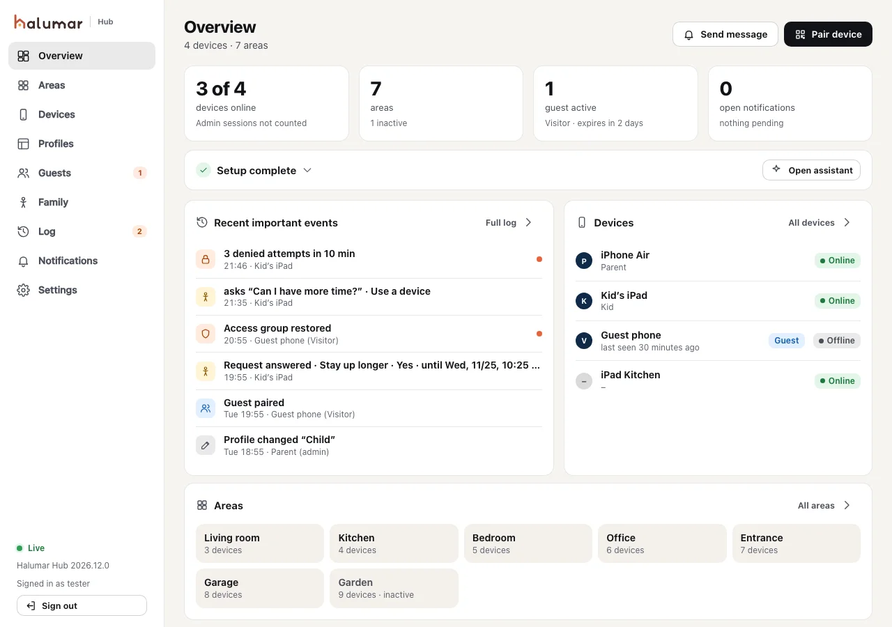

# A short tour of the admin page

The admin page is the **Halumar** entry in the Home Assistant sidebar. It opens through Home
Assistant (Ingress) and only for Home Assistant administrators. The menu on the left has nine
pages. This tour follows them in order. Labels are the English ones; the page follows the language
of your browser (English or German).

## Overview

What is online, active guests, open notifications, the most recent important events (alarms,
children's requests, new devices, profile changes), your devices and your areas. As long as the
first setup is not complete, the **Setup** checklist is shown here; **Open assistant** opens it
again later. The assistant has six steps: Integration, Connection, Addresses, First area, First
device, Finish.

**Pair device** (top right) opens the pairing dialog, **Send message** sends a notification.

## Areas

An area is one screen in the apps, usually a room. Create areas yourself or take rooms from Home
Assistant (Home Assistant stays unchanged). In an area you add a **Section**, an **Entity** or a
**Widget**, set width and height of each tile and see a preview per device type. **Properties**
holds the name, icon, image, tags and visibility of the area.

## Devices

Every paired device with its owner, status and profile. Open a device to see:

- **Effective rules**: every rule and where its value comes from (profile, fixed, adjustment).
  **Adjust** changes one rule for this device, also for a limited time; **Use profile value** and
  **Reset everything to the profile** take adjustments back.
- **Access now** with the switch **Access allowed**, for devices with access hours, guests,
  house sitters and babysitters.
- **Device in Home Assistant**: the entities the integration creates for this device.
- **Parent approval** for devices with parental controls, **Extend** for guests.
- **History** of every change with author and time, the activity of the device, and the
  removal of the device.

The list also shows **Set-ups in progress** when a paired phone or tablet is setting up another
device, and **Set up by** names who set a device up.

**Pair device** asks for **Member** or **Guest**, the **Owner**, the **Profile** (**Default per
device type** is preselected) and creates a PIN with a QR code. The PIN is valid for a short time;
**Copy setup link** gives a link that fills in address and PIN on the device.

## Profiles

There is no separate rules page: rules live in profiles. Every device has exactly one profile, and
a profile holds a value for every rule.

- Each rule shows on which device types it applies and whether it is **Enforced** (Home Assistant
  or the hub checks it) or **Applies in Halumar** (the app follows it).
- **Fixed** makes a rule the same on every device of the profile. Display and wall panel rules can
  be **User's choice**: the profile only gives the starting value.
- **Suggestions** are ready-made profiles; **Add** copies one into a profile of your own. When a
  suggestion has a **New version**, you decide whether to **Take over** the changes.
- **Default profiles** sets one profile per device type and for guests.
- **New profile**: from a suggestion, **From a device** or **Empty**.
- Every save shows **Preview & save** first: which devices change and which adjustments go away.

## Guests

Active guests with their end date, **+1 day** to extend, **Invite guest** to create a guest PIN,
and **Open invitations** that member devices created in the app (you can **Withdraw** them).
A guest access lasts at most 90 days per grant.

## Family

For homes with children: **Requests of the children** that are still open, **Family managers**
(parents' devices that may change the children's rules that are not fixed and answer their
requests), **Children**, and the family **Settings**. Parental controls themselves are a switch in
the profile.

## Log

Three tabs:

- **Entries**: **Activity** (who switched what, at home or away, what was refused and why),
  **Changes** (profiles, adjustments, guests, pairings, each with before, after and author) and
  **Alarms**. Filters and a CSV export.
- **Notifications**: which events send a message to which target (Home Assistant notification
  services or Halumar devices), with **Send test**.
- **Settings**: how long the log is kept (7, 30 or 90 days, default 30) and people hidden from
  the activity.

## Notifications

Messages to one device or all devices, with priority, color, scheduling and popup mode, and the
delivery state per device.

## Settings

Four tabs: **General**, **Network**, **Advanced** and **System & logs**.

- **General**: language and theme of the admin page, the name of the home, and the default
  control mode.
- **Network**: the Home Assistant addresses the apps use, and **Other addresses that count as
  home** (for example the range of a VPN; at most 10 private ranges).
- **Advanced**: **Admin page > Also open the admin page directly at home** (off by default, can
  only be switched from Home Assistant), the integration token (managed by the Supervisor on Home
  Assistant OS), whether the integration may start pairing, the admin API token, **Backup and
  restore** of the area configuration as JSON, and a danger zone to delete all areas or devices.
- **System & logs**: health and version, the connection to the integration, the TLS certificate
  with its fingerprint, restart, and the hub's log.

See also: the [user guide](../halumar/DOCS.md) for what each feature does, and the
[security model](security-model.md) for what the rules can and cannot prevent.
